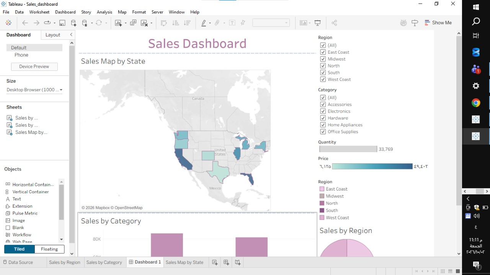
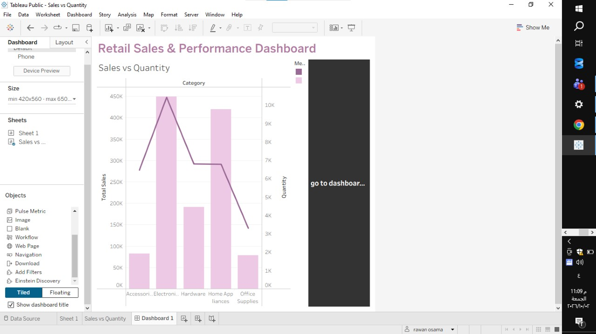

# Retail Sales & Performance Dashboard 📊

An advanced interactive Business Intelligence portfolio project built using **Tableau**, demonstrating complex data analysis, calculations, parameters, and dashboard interactions.

## 🚀 Project Overview
This project showcases a multi-page retail sales dashboard system designed to analyze business metrics, track category performance, and explore the correlation between sales and quantities.

## 🛠️ Key Features & Lab Requirements Implemented
1. **Calculated Fields:** Created custom measures including `Total Sales`, `Total Profit`, and `Profit Margin`.
2. **Parameters:** Implemented interactive parameters (`Top N Products` and `Sales Threshold`) to give users dynamic control.
3. **Wildcard Filter:** Added text-based wildcard filtering for flexible product/customer searches.
4. **Dual Axis Chart:** Designed a combined Dual-Axis visualization comparing `Total Sales` and `Quantity` across product categories.
5. **Multi-Dashboard Navigation:** Built a seamless navigation system between the primary sales overview dashboard and the secondary analytics dashboard.
6. **Dashboard Actions:** Integrated interactive filtering actions (`Select` triggers) for dynamic cross-highlighting.
7. **Tableau Public:** Published and shared live on the cloud.

---

## 📷 Dashboard Previews

### Dashboard 1: Sales Overview

### Dashboard 2: Advanced Sales vs Quantity Analysis

---
*Developed by Rawan Osama* 🚀
